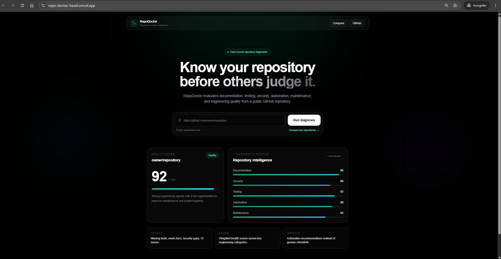

# 🩺 RepoDoctor

### Repository Health Intelligence for GitHub

**Analyze. Diagnose. Compare. Improve.**

RepoDoctor is an open-source repository intelligence platform that evaluates GitHub projects through measurable engineering signals, category-level health scores, and prioritized recommendations.

Understand how well a repository is documented, tested, secured, maintained, and prepared for collaboration—all from a single report.

[**Live Application**](https://repo-doctor-hazel.vercel.app) · [**Source Code**](https://github.com/Jewel777/RepoDoctor) · [**Releases**](https://github.com/Jewel777/RepoDoctor/releases) · [**Report an Issue**](https://github.com/Jewel777/RepoDoctor/issues)

---

## Project Status

[](https://repo-doctor-hazel.vercel.app)
[](https://github.com/Jewel777/RepoDoctor/releases)
[](LICENSE)

[](https://github.com/Jewel777/RepoDoctor/actions/workflows/ci.yml)
[](https://github.com/Jewel777/RepoDoctor/actions/workflows/codeql.yml)

---

## Overview

A repository can be active without being well maintained. It can have extensive documentation but lack automated testing, or use continuous integration while missing basic security controls.

**RepoDoctor brings these signals together into a structured engineering health assessment.**

Instead of manually reviewing repository configuration, workflows, documentation, and maintenance practices, developers can use RepoDoctor to identify strengths, detect gaps, and prioritize improvements.

### What You Can Do

| Capability | Description |
|---|---|
| **Health Assessment** | Evaluate repository health across core engineering categories. |
| **Repository Comparison** | Compare two public GitHub repositories using a consistent scoring engine. |
| **Security Analysis** | Identify security-related configuration and workflow signals. |
| **Engineering Diagnostics** | Examine testing, automation, documentation, and project setup. |
| **Improvement Planning** | Review prioritized issues and actionable recommendations. |
| **Maintenance Intelligence** | Understand activity, releases, and repository maintenance indicators. |

---

## Application Preview

### 01 / Repository Health Analysis

Get a structured overview of repository health, including an overall score, category-level results, diagnostic findings, and improvement recommendations.



### 02 / Side-by-Side Comparison

Evaluate two public repositories using the same assessment criteria. Explore category-level differences, overall results, and comparative strengths.


---

## Core Analysis Areas

RepoDoctor evaluates multiple aspects of repository engineering quality.

| Category | Evaluation Signals |
|---|---|
| 📚 **Documentation** | README quality, completeness, and supporting documentation |
| 🛡️ **Security** | Security policy, Dependabot, dependency controls, and scanning workflows |
| 🧪 **Testing** | Test files, testing frameworks, and testing-related configuration |
| ⚙️ **Automation** | GitHub Actions workflows, CI/CD configuration, and automation signals |
| 🔧 **Maintenance** | Repository activity, metadata, maintenance indicators, and release history |
| 🤝 **Community Health** | Contributing guidelines, issue templates, and pull request templates |
| 💻 **Code Quality** | TypeScript, linting, formatting, build scripts, environment templates, and Docker configuration |

**Important:** Scores reflect detectable repository signals. They are not guarantees of code correctness, security, or production readiness.

---

## Repository Comparison

**Introduced in v1.1**

RepoDoctor supports side-by-side comparisons to help developers examine the engineering practices of different open-source projects.

### How It Works

1. Enter the first public GitHub repository.
2. Enter a second public repository.
3. Run the comparison.
4. Review overall scores, category-level results, and category winners.

**Example repositories**

```text
Repository A: facebook/react
Repository B: vuejs/core
```

Both repositories are assessed using the same scoring engine, making it easier to identify differences in detectable engineering practices.

### Comparison Includes

- Overall repository health scores
- Category-by-category scoring
- Category winners
- Comparative analysis results
- Structured side-by-side presentation

[**Try Repository Comparison**](https://repo-doctor-hazel.vercel.app)

---

## How RepoDoctor Works

```text
       PUBLIC GITHUB REPOSITORY
                  |
                  v
          REPOSITORY DISCOVERY
                  |
                  v
           SIGNAL EXTRACTION
                  |
         +--------+--------+
         |        |        |
         v        v        v
      SECURITY  TESTING  DOCUMENTATION
         |        |        |
         +--------+--------+
                  |
                  v
         HEALTH SCORING ENGINE
                  |
                  v
        DIAGNOSTICS & FINDINGS
                  |
                  v
        ACTIONABLE HEALTH REPORT
```

The analysis combines repository metadata, file and configuration signals, and GitHub API information.

The scoring engine organizes the observed signals into health categories and produces findings that developers can use when reviewing a project.

---

## Engineering Capabilities

Beyond basic metadata inspection, RepoDoctor supports several engineering-focused checks and operational features.

**Repository intelligence**
- Repository metadata and maintenance analysis
- README structure and completeness evaluation
- Release-history and versioning signals
- Large-repository safe scanning

**Development practices**
- Automated test-file and testing-framework detection
- CI/CD workflow inspection
- TypeScript and code-quality tooling checks
- Build scripts, Docker, and environment-template detection

**Security and collaboration**
- Security policy and security-scanning checks
- Dependabot and dependency-lockfile checks
- Contributing guidelines
- Issue and pull request templates

**Reporting and reliability**
- Prioritized critical issues and recommendations
- Passed-check visibility
- Authenticated GitHub API support
- Responsive desktop and mobile interface

---

## Getting Started

### Option 1 — Use the Live Application

No local installation is required to analyze a public GitHub repository.

1. Open [RepoDoctor](https://repo-doctor-hazel.vercel.app).
2. Enter a public GitHub repository URL.
3. Run the analysis.
4. Review the resulting health report.

Use the comparison feature when you want to evaluate two projects side by side.

### Option 2 — Explore the Source

Access the repository to inspect the implementation, review the project structure, or contribute.

```bash
git clone https://github.com/Jewel777/RepoDoctor.git
cd RepoDoctor
```

Consult the project configuration for local setup and environment requirements.

---

## Who Is RepoDoctor For?

| Audience | Use Case |
|---|---|
| **Open-source maintainers** | Identify repository maintenance and quality gaps. |
| **Software developers** | Review engineering practices before adopting or contributing to a project. |
| **Engineering teams** | Compare repositories using consistent, visible criteria. |
| **Students and researchers** | Explore repository engineering signals and evaluation methods. |
| **Project contributors** | Understand where documentation, testing, or collaboration practices can improve. |

---

## Roadmap

Potential directions for future development include:

- More detailed scoring explanations
- Historical repository health tracking
- Expanded language and framework support
- Repository health trends and visualizations
- Exportable analysis reports
- Broader engineering and security signal coverage

Roadmap items are proposed directions, not committed release features.

---

## Contributing

Contributions, bug reports, feature suggestions, and technical discussions are welcome.

If you would like to improve RepoDoctor:

1. Review existing [issues](https://github.com/Jewel777/RepoDoctor/issues).
2. Open an issue to discuss a proposed change.
3. Fork the repository and create a feature branch.
4. Submit a pull request with a clear description of your changes.

For security-related concerns, use the project's private vulnerability reporting process when available rather than publicly disclosing sensitive details.

---

## License

RepoDoctor is released under the [MIT License](LICENSE).

---

### Built for Better Repository Engineering

**RepoDoctor turns scattered repository signals into structured engineering insight.**

[**Explore RepoDoctor**](https://repo-doctor-hazel.vercel.app) · [**View on GitHub**](https://github.com/Jewel777/RepoDoctor) · [**Open an Issue**](https://github.com/Jewel777/RepoDoctor/issues)

