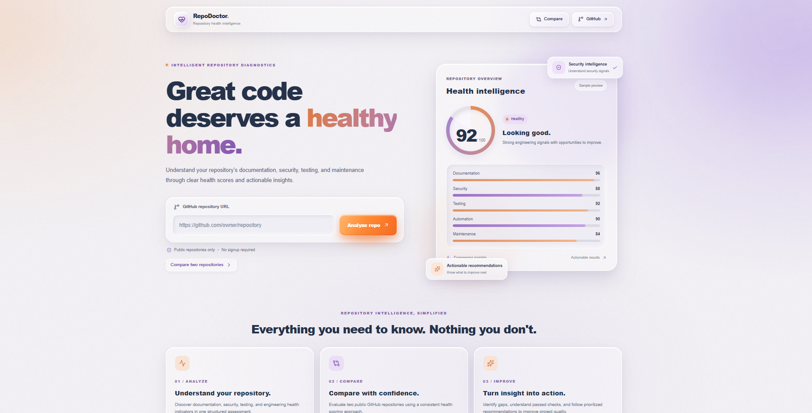
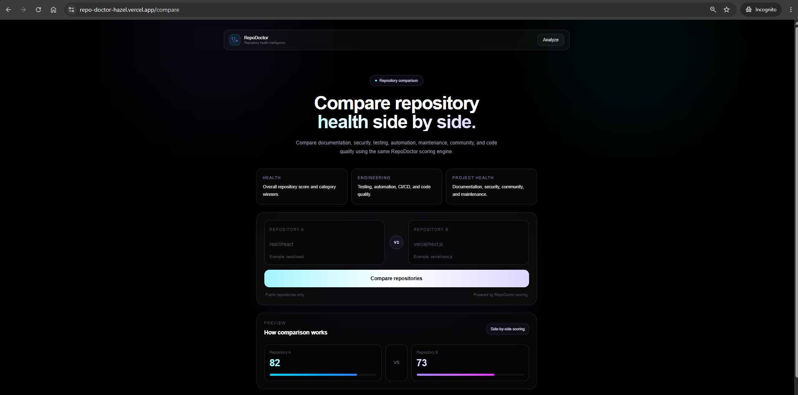

<div align="center">

# 🩺 RepoDoctor

### Your GitHub Repository Deserves a Health Check.

**Analyze smarter. Compare better. Build stronger.**

An open-source repository intelligence tool that transforms GitHub repository data into meaningful health scores, engineering insights, and actionable recommendations.

[](https://repo-doctor-hazel.vercel.app)
[](https://github.com/Jewel777/RepoDoctor)

<br>

[](https://github.com/Jewel777/RepoDoctor/actions/workflows/ci.yml)
[](https://github.com/Jewel777/RepoDoctor/actions/workflows/codeql.yml)
[](https://github.com/Jewel777/RepoDoctor/releases)
[](LICENSE)

---

**[Overview](#-why-repodoctor) • [Live Preview](#-see-repodoctor-in-action) • [Features](#-what-can-repodoctor-analyze) • [Comparison](#-compare-two-repositories) • [Installation](#-get-started)**

</div>

## 💡 Why RepoDoctor?

A repository can have thousands of stars and still lack essential engineering practices.

How do you know whether a GitHub project has proper testing, security policies, automation, documentation, and maintenance?

Manually reviewing these details takes time.

**RepoDoctor simplifies that process.**

Enter a public GitHub repository and receive a structured health assessment that highlights its strengths, identifies missing practices, and recommends improvements.

<table>
<tr>
<td width="50%">

### 🔎 Discover Problems

Identify gaps in documentation, testing, security, and engineering workflows.

</td>
<td width="50%">

### 📊 Understand Health

Explore repository health scores and individual category assessments.

</td>
</tr>
<tr>
<td width="50%">

### 🛠️ Improve Quality

Use prioritized recommendations to strengthen repository practices.

</td>
<td width="50%">

### ⚖️ Compare Projects

Evaluate two repositories side by side using the same scoring approach.

</td>
</tr>
</table>

---

## 🖥️ See RepoDoctor in Action

### 01 — Repository Health Analysis

**One repository. One comprehensive engineering overview.**

Enter a public GitHub repository URL to inspect its engineering health.

The report combines category scores, repository metadata, passed checks, critical findings, and recommendations into an understandable assessment.



<div align="center">

*Explore the repository analysis experience.*

</div>

### 02 — Repository Comparison

**Two projects. One consistent evaluation.**

RepoDoctor v1.1 introduces side-by-side repository comparison.

Understand how two open-source projects differ in documentation, security, testing, maintenance, automation, and other engineering categories.



<div align="center">

[](https://repo-doctor-hazel.vercel.app)

</div>

---

## 🚀 How It Works

<table>
<tr align="center">
<td width="33%">

### 01

**ENTER**

Paste a public GitHub repository URL.

</td>
<td width="33%">

### 02

**ANALYZE**

RepoDoctor evaluates detectable engineering signals and repository configuration.

</td>
<td width="33%">

### 03

**IMPROVE**

Review findings, category scores, and prioritized recommendations.

</td>
</tr>
</table>

**Example repository:**

```text
https://github.com/facebook/react
```

No local repository download is required to use the live analyzer.

---

## 🧩 What Can RepoDoctor Analyze?

RepoDoctor evaluates seven core areas of repository health.

| Category | What RepoDoctor Checks |
|:---|:---|
| 📚 **Documentation** | README quality, completeness, and supporting documentation |
| 🛡️ **Security** | Security policies, Dependabot, dependency lockfiles, and scanning configuration |
| 🧪 **Testing** | Test files, testing frameworks, and testing-related signals |
| ⚙️ **CI/CD & Automation** | GitHub Actions and automation workflows |
| 🔧 **Maintenance** | Repository activity, metadata, and release practices |
| 🤝 **Community Health** | Contribution guidelines and issue / pull request templates |
| 💻 **Engineering Quality** | TypeScript, linting, formatting, build scripts, environment templates, and Docker |

### Beyond Basic Repository Scanning

RepoDoctor also provides:

- Overall and category-level health scoring
- Prioritized critical issues and improvement recommendations
- Passed-check visibility
- Repository metadata and release intelligence
- Large-repository safe scanning
- Authenticated GitHub API support
- Responsive desktop and mobile interface

> **Note:** RepoDoctor scores detectable repository practices. A high score does not guarantee secure, bug-free, or production-ready software.

---

## ⚖️ Compare Two Repositories

Choosing between open-source projects?

RepoDoctor helps you compare their detectable engineering practices without manually inspecting every configuration file.

**Example: React vs. Vue**

```text
Repository A: facebook/react
Repository B: vuejs/core
```

### Comparison Results Include

| Evaluation | Description |
|:---|:---|
| Overall Health | Overall assessment for each repository |
| Category Scores | Side-by-side engineering category results |
| Category Winners | Highlights areas where each project scores higher |
| Comparative Results | Structured comparison using consistent criteria |

**A higher repository health score does not necessarily mean better application code.** Use the findings as one input when evaluating software projects.

---

## 👥 Who Is RepoDoctor For?

<table>
<tr>
<td width="50%">

**👨‍💻 Developers**

Understand the engineering practices of unfamiliar repositories.

</td>
<td width="50%">

**🧑‍🔧 Maintainers**

Discover improvements needed to strengthen open-source projects.

</td>
</tr>
<tr>
<td width="50%">

**🏢 Engineering Teams**

Compare repository practices across public projects.

</td>
<td width="50%">

**🎓 Students & Researchers**

Explore practical repository engineering and maintenance signals.

</td>
</tr>
</table>

---

## 🛠️ Get Started

### Option 1 — Use Online

Open the live application:

**https://repo-doctor-hazel.vercel.app**

Enter a public GitHub repository URL and start analyzing.

### Option 2 — Run Locally

**Requirements:** Node.js 24 and npm.

Clone the repository:

```bash
git clone https://github.com/Jewel777/RepoDoctor.git
cd RepoDoctor
```

Install dependencies:

```bash
npm ci
```

Start the development server:

```bash
npm run dev
```

Open:

```text
http://localhost:3000
```

### Development Commands

| Command | Purpose |
|:---|:---|
| `npm run dev` | Start development server |
| `npm run lint` | Run ESLint |
| `npm run typecheck` | Check TypeScript |
| `npm test` | Run automated tests |
| `npm run build` | Create production build |
| `npm audit` | Check dependency advisories |

---

## ⚡ Technology Stack

<div align="center">


</div>

RepoDoctor uses **Next.js, React, TypeScript, and Tailwind CSS**, with Vitest for testing, ESLint for code quality, GitHub Actions for CI, and CodeQL for security analysis.

---

## 🤝 Contributing

RepoDoctor is open source, and contributions are welcome.

You can contribute by:

1. Reporting bugs or incorrect analysis results.
2. Suggesting new repository health checks.
3. Improving documentation or the user interface.
4. Submitting focused pull requests.

Read the repository's contributing guidelines before making substantial changes.

[](https://github.com/Jewel777/RepoDoctor/issues)

---

## 📄 License

Distributed under the **MIT License**.

See [LICENSE](LICENSE) for details.

---

<div align="center">

## 🩺 Build Healthier Repositories.

**Better visibility. Better engineering decisions.**

Make repository health easier to understand, compare, and improve.

[](https://repo-doctor-hazel.vercel.app)

<br>

[GitHub Repository](https://github.com/Jewel777/RepoDoctor) · [Report an Issue](https://github.com/Jewel777/RepoDoctor/issues) · [Releases](https://github.com/Jewel777/RepoDoctor/releases)

<sub>Made for developers, maintainers, and open-source communities.</sub>

</div>
